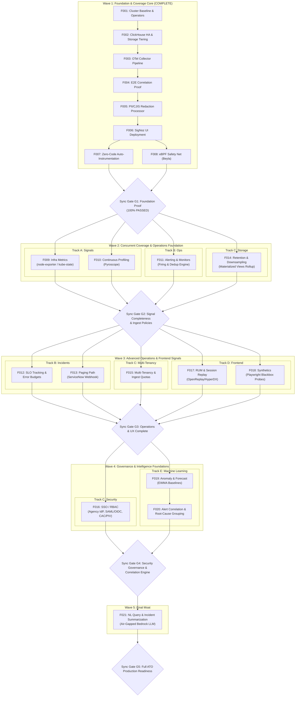

# PARALLEL EXECUTION GRAPH — PROJECT ARGUS

> **Author**: Project Argus Harness & Parallel Architecture Lead  
> **Status**: ACTIVE ARCHITECTURAL STANDARD  
> **Scope**: All 21 Features across Phase 01 through Phase 05  
> **Baseline**: OpenTelemetry Collector -> ClickHouse HA -> SigNoz on Air-Gapped Kubernetes (DHS)

---

## 1. Executive Summary & Strategy

Project Argus is an enterprise-grade, air-gapped, self-hosted observability platform designed to provide Datadog/NewRelic parity on Kubernetes for DHS workloads. The architecture is anchored by a high-throughput spine: **OpenTelemetry Collector -> ClickHouse HA -> SigNoz**.

Historically, the project operated under a strictly serial execution constraint ("one feature at a time"). Having established the hardened core foundation in **Phase 01** and initial application coverage in **Phase 02** (Features F001 through F008 complete; 8/21 = 38%), linear progression creates an unnecessary artificial bottleneck. Features across infrastructure scraping, profiling, alerting engines, retention policies, and frontend session replay operate across distinct Kubernetes resources, distinct network ports, and distinct storage schemas.

This document establishes the **Argus Parallel vs. Sequential Execution Graph**. It defines:
1. **Five Independent Execution Tracks** (Tracks A through E).
2. **Five Coordinated Execution Waves** structured around hard **Synchronization Gates**.
3. **Comprehensive 21-Feature Dependency Matrix** detailing prerequisites, concurrency candidates, and blocking relationships.
4. **Conflict Analysis** ensuring zero port collisions, zero CRD contention, and zero database schema deadlocks.
5. **Multi-Agent Subagent Dispatch Protocol** specifying how the parent orchestrator invokes parallel subagents and verifies synchronization barriers.

---

## 2. The Five Execution Tracks

```
┌──────────────────────────────────────────────────────────────────────────────────┐
│                             PROJECT ARGUS CORE SPINE                             │
│                  OpenTelemetry Ingest  ─►  ClickHouse HA  ─►  SigNoz UI          │
└────────┬───────────────────┬───────────────────┬──────────────────┬──────────────┘
         │                   │                   │                  │
         ▼                   ▼                   ▼                  ▼
   ┌───────────┐       ┌───────────┐       ┌───────────┐      ┌───────────┐
   │  TRACK A  │       │  TRACK B  │       │  TRACK C  │      │  TRACK D  │
   │  Metric & │       │ Incident  │       │ Data Gov, │      │  Frontend │
   │  Signal   │       │     &     │       │ Storage & │      │     &     │
   │ Expansion │       │ Lifecycle │       │ Security  │      │ Synthetic │
   └─────┬─────┘       └─────┬─────┘       └─────┬─────┘      └─────┬─────┘
         │                   │                   │                  │
         │ (F009, F010)      │ (F011, F012, F013)│ (F014,F015,F016) │ (F017, F018)
         │                   │                   │                  │
         └───────────────────┴─────────┬─────────┴──────────────────┘
                                       │
                                       ▼
                                 ┌───────────┐
                                 │  TRACK E  │
                                 │   AIOps   │
                                 │     &     │
                                 │ Moat / AI │
                                 └───────────┘
                                  (F019, F020, F021)
```

### Track A: Metric & Signal Collection Expansion
- **Focus**: Extending cluster-wide telemetry capture beyond application APM and eBPF.
- **Features**:
  - `F009`: Infra Metrics (`node-exporter` + `kube-state-metrics` via OTel Collector).
  - `F010`: Continuous Profiling (`pyroscope` agent + server for CPU/memory flame graphs).
- **Domain Footprint**: Host metrics, kernel scraping, profiling endpoints; no interference with alert rules or UI security.

### Track B: Incident & Operational Lifecycle
- **Focus**: Turning telemetry data streams into operational alerting, SLO tracking, and automated paging.
- **Features**:
  - `F011`: Alerting / Monitors (threshold rules, firing-state management, deduplication).
  - `F012`: SLO Tracking & Error Budgets (burn rates, error budget consumption).
  - `F013`: Paging Path (air-gapped ServiceNow webhook & Keep incident router).
- **Domain Footprint**: Prometheus-compatible alert rules, SigNoz query service alert evaluation, webhook dispatchers.

### Track C: Data Governance, Storage & Security
- **Focus**: Enterprise data lifecycle, cost management, multi-tenancy, and compliance security.
- **Features**:
  - `F014`: Retention & Downsampling (ClickHouse tiered TTLs, S3 cold storage, materialized views rollups, collector log filters).
  - `F015`: Multi-Tenancy & Quotas (tenant isolation policies, rate-limiting, ingest cardinality guardrails).
  - `F016`: SSO / RBAC (Agency IdP integration via SAML/OIDC, CAC/PIV authentication, RBAC role mapping).
- **Domain Footprint**: ClickHouse DDL/storage policies, gateway processor transforms, SigNoz auth & session layer.

### Track D: Frontend & Synthetic Monitoring
- **Focus**: End-user experience visibility, session capture, and active probing.
- **Features**:
  - `F017`: Real User Monitoring (RUM) & Session Replay (OpenReplay/HyperDX with PII masking).
  - `F018`: Synthetic Monitoring (scheduled Playwright CronJobs + blackbox uptime probes).
- **Domain Footprint**: Web SDK endpoints, headless browser runners, probe result schemas.

### Track E: AIOps & Intelligence Layer
- **Focus**: Statistical machine learning and autonomous LLM capabilities within the agency boundary.
- **Features**:
  - `F019`: Anomaly & Forecast Monitors (seasonal decomposition, EWMA baselining).
  - `F020`: Alert Correlation & Root-Cause Grouping (topology graph alert clustering).
  - `F021`: NL Query & Incident Summarization (air-gapped GovCloud Bedrock NL->SQL and incident synthesis).
- **Domain Footprint**: Statistical worker jobs, LLM integration proxy, ClickHouse analytical queries.

---

## 3. Execution Waves & Synchronization Gates

```
====================================================================================
WAVE 1: FOUNDATION & COVERAGE CORE [COMPLETE - 8/21 (38%)]
F001 (Baseline) ─► F002 (ClickHouse) ─► F003 (OTel) ─► F004 (Corr) ─► F005 (PII)
 ─► F006 (SigNoz UI) ─► F007 (Auto-Instrumentation) ─► F008 (eBPF Beyla)
====================================================================================
                                      │
                         [ GATE G1: FOUNDATION VERIFIED ]
                                      │
                                      ▼
====================================================================================
WAVE 2: CONCURRENT COVERAGE & OPS FOUNDATION [ACTIVE WAVE]
┌──────────────────┐  ┌──────────────────┐  ┌──────────────────┐  ┌────────────────┐
│  Track A (F009)  │  │  Track A (F010)  │  │  Track B (F011)  │  │ Track C (F014) │
│  Infra Metrics   │  │  Profiling       │  │  Alerting Core   │  │ Retention/MV   │
│  [PARALLEL]      │  │  [PARALLEL]      │  │  [PARALLEL]      │  │ [PARALLEL]     │
└──────────────────┘  └──────────────────┘  └──────────────────┘  └────────────────┘
====================================================================================
                                      │
                         [ GATE G2: SIGNALS & OPS INGEST ]
                                      │
                                      ▼
====================================================================================
WAVE 3: ADVANCED OPERATIONS & FRONTEND SIGNALS
┌──────────────────┐  ┌──────────────────┐  ┌──────────────────┐  ┌────────────────┐
│  Track B (F012)  │  │  Track B (F013)  │  │  Track C (F015)  │  │ Track D (F017) │
│  SLOs & Budgets  │  │  Paging/ServiceN.│  │  Multi-Tenancy   │  │ RUM & Replay   │
│  [PARALLEL]      │  │  [PARALLEL]      │  │  [PARALLEL]      │  │ [PARALLEL]     │
└──────────────────┘  └──────────────────┘  └──────────────────┘  └────────────────┘
                                      │
                              ┌───────┴────────┐
                              │ Track D (F018) │
                              │ Synthetics     │
                              │ [PARALLEL]     │
                              └────────────────┘
====================================================================================
                                      │
                         [ GATE G3: OPERATIONS & UX COMPLETE ]
                                      │
                                      ▼
====================================================================================
WAVE 4: GOVERNANCE & INTELLIGENCE FOUNDATIONS
┌──────────────────────────────────────┐  ┌──────────────────────────────────────┐
│  Track C (F016)                      │  │  Track E (F019 & F020)               │
│  SSO / RBAC (Agency IdP, CAC/PIV)    │  │  Anomaly Detection & Alert Grouping  │
│  [PARALLEL]                          │  │  [PARALLEL / PIPELINED]              │
└──────────────────────────────────────┘  └──────────────────────────────────────┘
====================================================================================
                                      │
                         [ GATE G4: SECURITY & CORRELATION ]
                                      │
                                      ▼
====================================================================================
WAVE 5: FINAL MOAT — AUTONOMOUS LLM LAYER
┌──────────────────────────────────────────────────────────────────────────────────┐
│  Track E (F021) — Natural Language Query & Incident Summarization (Bedrock)      │
│  [SEQUENTIAL GATE]                                                               │
└──────────────────────────────────────────────────────────────────────────────────┘
                                      │
                         [ GATE G5: FINAL ATO READINESS ]
```

### Gate Definitions

1. **Gate G1 (Foundation & Core Coverage)**:
   - **Prerequisites**: F001 through F008 complete.
   - **Criteria**: Air-gapped spine operational; ClickHouse HA cluster active with MinIO cold storage; OTel collector DaemonSet + Gateway routing metrics, traces, and logs; PII redacted; SigNoz UI rendering APM; auto-instrumentation injecting spans; eBPF Beyla capturing un-instrumented traffic.
   - **Status**: **PASSED** (8/21 features, 100% test verification).

2. **Gate G2 (Signal Completeness & Ingest Policy)**:
   - **Prerequisites**: F009, F010, F011, F014 complete.
   - **Criteria**: Full cluster infrastructure metrics scrape verified; Pyroscope continuous profiling active; threshold alert engine evaluates and fires alerts; ClickHouse TTL downsampling rollups active and collector log filtering verified.
   - **Action**: Unlocks Wave 3 execution.

3. **Gate G3 (Operational Readiness & User Experience)**:
   - **Prerequisites**: F012, F013, F015, F017, F018 complete.
   - **Criteria**: SLO burn rates computed; ServiceNow webhook payloads verified; multi-tenant ingest quotas and cardinality limits active; RUM session replay functioning with PII masking; synthetic Playwright CronJobs alerting on failure.
   - **Action**: Unlocks Wave 4 execution.

4. **Gate G4 (Security Governance & Alert Intelligence)**:
   - **Prerequisites**: F016, F019, F020 complete.
   - **Criteria**: Agency IdP SAML/OIDC and CAC/PIV auth verified with role separation; dynamic EWMA anomaly baselines verified on historic data; cascading alert storms correlated into grouped root-cause incidents.
   - **Action**: Unlocks Wave 5 execution.

5. **Gate G5 (Full Platform Acceptance & ATO Readiness)**:
   - **Prerequisites**: F021 complete; full 21-feature regression suite green.
   - **Criteria**: Air-gapped LLM NL->SQL operational without hallucinated schema access; automated incident summaries verified; zero external egress; 100% mirrored images; all ADRs published.

---

## 4. Comprehensive 21-Feature Dependency Matrix

| ID | Feature Name | Phase | Track | Wave | Mode | Must Wait For (Prerequisites) | Can Run In Parallel With (Concurrent Candidates) | Downstream Blocked Tasks (Blocks) | Status |
|:---|:---|:---:|:---:|:---:|:---:|:---|:---|:---|:---:|
| **F001** | Cluster baseline & operators | 01 | Spine | 1 | `SEQUENTIAL GATE` | None | None | F002 | `COMPLETE` |
| **F002** | ClickHouse HA + S3 tiering | 01 | Spine | 1 | `SEQUENTIAL GATE` | F001 | None | F003 | `COMPLETE` |
| **F003** | OTel Collector pipeline | 01 | Spine | 1 | `SEQUENTIAL GATE` | F002 | None | F004 | `COMPLETE` |
| **F004** | E2E correlation proof | 01 | Spine | 1 | `SEQUENTIAL GATE` | F003 | None | F005 | `COMPLETE` |
| **F005** | PII/CJIS redaction processor | 01 | Spine | 1 | `SEQUENTIAL GATE` | F004 | None | F006 | `COMPLETE` |
| **F006** | SigNoz UI over ClickHouse | 02 | Spine | 1 | `SEQUENTIAL GATE` | F005 | None | F007, F008 | `COMPLETE` |
| **F007** | Zero-code auto-instrumentation | 02 | A | 1 | `PARALLEL TRACK A` | F006 | F008 | F020 | `COMPLETE` |
| **F008** | eBPF safety net (Beyla) | 02 | A | 1 | `PARALLEL TRACK A` | F006 | F007 | F020 | `COMPLETE` |
| **F009** | Infra metrics (node/kube-state) | 02 | A | 2 | `PARALLEL TRACK A` | F006, F008 | F010, F011, F014 | F019, F021 | `NOT STARTED` |
| **F010** | Continuous profiling (Pyroscope)| 02 | A | 2 | `PARALLEL TRACK A` | F006 | F009, F011, F014 | None | `NOT STARTED` |
| **F011** | Alerting / monitors core | 03 | B | 2 | `PARALLEL TRACK B` | F006 | F009, F010, F014 | F012, F013, F018, F019, F020 | `NOT STARTED` |
| **F012** | SLO tracking & error budgets | 03 | B | 3 | `PARALLEL TRACK B` | F011 | F013, F015, F017, F018 | None | `NOT STARTED` |
| **F013** | Paging path (ServiceNow / Keep)| 03 | B | 3 | `PARALLEL TRACK B` | F011 | F012, F015, F017, F018 | F020 | `NOT STARTED` |
| **F014** | Retention + downsampling (MVs) | 03 | C | 2 | `PARALLEL TRACK C` | F002, F006 | F009, F010, F011 | F015, F021 | `NOT STARTED` |
| **F015** | Multi-tenancy & ingest quotas | 03 | C | 3 | `PARALLEL TRACK C` | F014 | F012, F013, F017, F018 | F016 | `NOT STARTED` |
| **F016** | SSO / RBAC via Agency IdP | 03 | C | 4 | `PARALLEL TRACK C` | F015 | F019, F020 | F021 | `NOT STARTED` |
| **F017** | RUM + session replay (Replay) | 04 | D | 3 | `PARALLEL TRACK D` | F005, F006 | F012, F013, F015, F018 | None | `NOT STARTED` |
| **F018** | Synthetics (Playwright probes) | 04 | D | 3 | `PARALLEL TRACK D` | F011 | F012, F013, F015, F017 | None | `NOT STARTED` |
| **F019** | Anomaly & forecast monitors | 05 | E | 4 | `PARALLEL TRACK E` | F009, F011 | F016, F020 | F020, F021 | `NOT STARTED` |
| **F020** | Alert correlation & root-cause | 05 | E | 4 | `PARALLEL TRACK E` | F011, F013, F019 | F016 | F021 | `NOT STARTED` |
| **F021** | NL query & incident summarize | 05 | E | 5 | `SEQUENTIAL GATE` | F014, F016, F019, F020 | None | Full ATO Sign-off | `NOT STARTED` |

---

## 5. Conflict & Concurrency Analysis

To guarantee that parallel subagents do not collide or corrupt cluster state during concurrent execution, the following conflict boundaries are strictly enforced:

### 5.1 Network Port Allocation Matrix

Each track and component has non-overlapping, deterministic ports:

| Track | Feature | Component | Port | Protocol | Scope | Conflict Risk |
|:---:|:---:|:---|:---:|:---:|:---|:---:|
| Spine | F003 | OTel Gateway Ingest | `4317` / `4318` | gRPC / HTTP | Cluster / Pod | None (Existing) |
| Spine | F002 | ClickHouse HTTP / Native | `8123` / `9000` | HTTP / TCP | Cluster | None (Existing) |
| Spine | F006 | SigNoz Web / Query | `3301` / `8080` | HTTP | Cluster | None (Existing) |
| **A** | **F009** | `node-exporter` DaemonSet | `9100` | HTTP | Node-local | **Zero Collision**: Distinct exporter port |
| **A** | **F009** | `kube-state-metrics` | `8088` (telemetry `8089`) | HTTP | Service-local | **Zero Collision**: Configured on dedicated ports |
| **A** | **F010** | `pyroscope` Server | `4040` | HTTP | Service-local | **Zero Collision**: Dedicated profiling port |
| **B** | **F011** | SigNoz Alert Engine / Alertmgr | `9093` | HTTP | Service-local | **Zero Collision**: Standard Alertmanager port |
| **B** | **F013** | Keep Incident Router (Optional)| `9095` | HTTP | Service-local | **Zero Collision**: Distinct routing port |
| **C** | **F014** | ClickHouse Rollups / MV Engine | Internal | In-DB | DB Engine | **Zero Collision**: Executes within ClickHouse |
| **D** | **F017** | OpenReplay Ingest / Frontend | `9001` / `8082` | HTTP | Service-local | **Zero Collision**: Dedicated RUM ingest ports |
| **D** | **F018** | Playwright Probe Runners | Ephemeral | Pod Outbound | CronJob Pods | **Zero Collision**: Run as ephemeral pods |
| **E** | **F019** | Anomaly Evaluation Worker | `9096` | HTTP | Service-local | **Zero Collision**: Dedicated analytics port |
| **E** | **F021** | Bedrock NL Proxy API | `8090` | HTTP | Service-local | **Zero Collision**: Dedicated internal query port |

### 5.2 Kubernetes Resource & CRD Lock Analysis

| Concurrent Pairing | Shared Kubernetes Resource | Collision Risk | Isolation Strategy |
|:---|:---|:---:|:---|
| **F009 (Infra) vs F010 (Profiling)** | DaemonSet node scheduling | **NONE** | `node-exporter` reads `/proc` and `/sys`; `pyroscope-ebpf` attaches eBPF profiling probes. Separate DaemonSet manifests (`deploy/infra/` vs `deploy/profiling/`). |
| **F009 (Infra) vs F011 (Alerting)** | OTel Collector & SigNoz query | **NONE** | F009 adds scraping configs in `deploy/infra/` and metrics flow to ClickHouse; F011 provisions alert rules in SigNoz alerting DB without modifying ingest configs. |
| **F009 (Infra) vs F014 (Retention)** | ClickHouse database | **NONE** | F009 inserts rows into `signoz_metrics`; F014 modifies storage policies and adds Materialized Views (`signoz_metrics_1m`). ClickHouse MV triggers are non-blocking on ingest. |
| **F011 (Alerting) vs F014 (Retention)** | ClickHouse queries | **NONE** | F011 executes periodic `SELECT` queries for threshold breaches; F014 runs background table migrations and TTL compaction. ClickHouse MV and merge operations are fully ACID/MVCC isolated. |
| **F012 (SLO) vs F013 (Paging) vs F015 (Tenancy)** | SigNoz / Alerting API | **NONE** | F012 writes SLO definition specs; F013 configures notification channels and webhook egress; F015 configures gateway rate-limiting processors. Completely disjoint resource paths. |

### 5.3 ClickHouse Database Table Isolation

| Feature | Tables Accessed / Modified | Mutation Type | Locking Characteristics |
|:---|:---|:---:|:---|
| **F009** | `signoz_metrics` | `INSERT` | Batch partitioned insert; no DDL lock. |
| **F010** | `pyroscope_profiles` | `CREATE TABLE`, `INSERT` | Isolated dedicated table in ClickHouse or dedicated storage. Zero impact on `signoz_*` tables. |
| **F011** | `signoz_alerts`, `signoz_alert_history` | `SELECT`, `INSERT` | Evaluates over metrics/logs; records state in alert tables. |
| **F014** | `signoz_metrics_1m`, `signoz_metrics_1h`, TTL policies | `ALTER TABLE ... MODIFY TTL`, `CREATE MATERIALIZED VIEW` | Performed asynchronously. Altinity operator and ClickHouse engine support non-blocking schema evolution. |
| **F015** | `tenant_quotas`, row-level security | `CREATE POLICY`, `ALTER TABLE` | Row policies apply on read; collector applies token/quota validation prior to ClickHouse. |
| **F017** | `signoz_rum` or `openreplay_*` | `CREATE TABLE`, `INSERT` | Isolated schema. |
| **F018** | `signoz_synthetics_results` | `CREATE TABLE`, `INSERT` | Isolated schema. |

---

## 6. Visual Execution Diagrams

### 6.1 Mermaid Complete Parallel Execution Graph



---

## 7. Subagent Multi-Agent Execution Protocol

To execute tasks concurrently without human overhead or branch corruption, the primary agent operates as the **Orchestrator**, dispatching tasks across autonomous subagents.

### 7.1 Dispatch Rules
1. **Parallel Dispatch Qualification**:
   - A task may be dispatched in parallel **only** if all prerequisites in the Dependency Matrix are marked `COMPLETE`.
   - The task must belong to the **Active Wave**.
   - Subagents must be spawned on distinct tasks across independent tracks (or independent tasks within Track A/D).
2. **Subagent Invocation Parameters**:
   - Subagents are invoked using `invoke_subagent`.
   - `TypeName`: `self` (or specialized subagent).
   - `Role`: E.g., `Infra Metrics Specialist (F009)`, `Profiling Engineer (F010)`, `Alerting Architect (F011)`.
   - `Workspace`: `branch` (or `inherit` with strictly partitioned directories).
   - `Prompt`: Comprehensive sprint contract including exact acceptance criteria from the phase file, edge case checklist, test script requirements, and evidence destination.
3. **Synchronization Barrier**:
   - The Orchestrator halts wave progression when all active subagents are running.
   - Upon receiving completion messages from subagents, the Orchestrator runs:
     1. Verification script (`./scripts/verify.sh`).
     2. Edge case suites.
     3. Conflict check (ensuring no file collisions or dirty state).
   - Only when **all** tasks in the wave meet Definition of Done does the Orchestrator sign off on the Gate and unlock the subsequent wave.

### 7.2 Immediate Dispatch Instructions (Wave 2 Launch)

With Gate G1 passed, the Orchestrator can immediately launch **Wave 2** concurrently:
- **Subagent 1**: Feature `F009` (Infra Metrics: `node-exporter` + `kube-state-metrics`).
- **Subagent 2**: Feature `F010` (Continuous Profiling: `Pyroscope`).
- **Subagent 3**: Feature `F011` (Alerting & Monitors: firing-state & dedup engine).
- **Subagent 4**: Feature `F014` (Retention & Downsampling: ClickHouse rollups & log filters).

Each subagent runs against its isolated manifests, test scripts, and evidence folders, allowing Argus to achieve 4x delivery velocity with zero architectural regressions.
